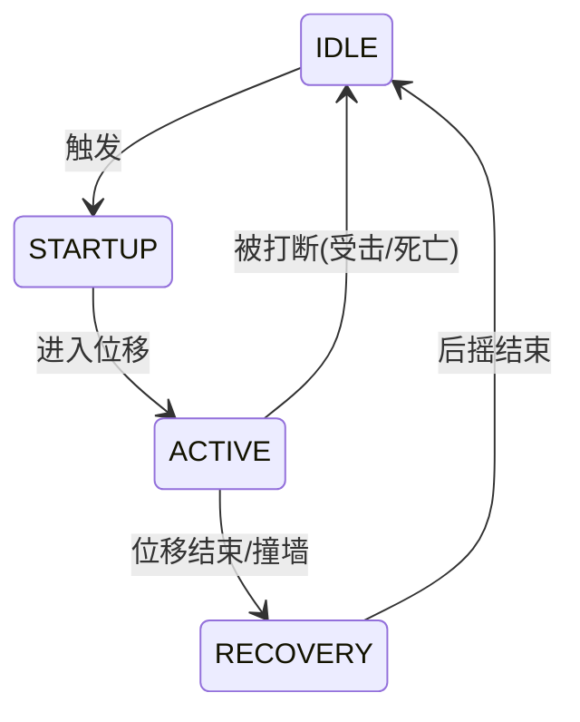

# OurDungeonCraft — 交接手册

> 最后更新：2026-10-27

## 1. 项目目标

把 *Minecraft Dungeons* 的内容与战斗手感搬运到 Minecraft（Fabric 模组），
**核心诉求是炫酷的动作设计**（翻滚、连击、蓄力、处决等）。

## 2. 技术栈

| 项目 | 值 | 备注 |
|---|---|---|
| Minecraft | `1.21.11` | 版本很新，第三方动画库兼容性需先验证 |
| Fabric Loader | `0.20.1` | |
| Fabric API | `0.141.6+1.21.11` | |
| Fabric Loom | `1.19-SNAPSHOT` | 插件 id：`net.fabricmc.fabric-loom-remap` |
| Java | `21` | `options.release = 21` |
| 映射 | 官方 Mojang 映射 | `loom.officialMojangMappings()` |
| Mod ID | `ourdungeoncraft` | |
| 包名 / group | `com.github.ztymilk` | |
| 版本 | `1.0.0` | |

### 1.21.11 相关注意点

- `Identifier` 位于 `net.minecraft.resources.Identifier`（**不是**旧的 `ResourceLocation`）。
  项目已封装工具方法 `OurDungeonCraft.id(String)`。
- 官方模板引入了 **JSpecify** `@NullMarked`（见 `package-info.java`），
  整个 `com.github.ztymilk` 包默认非空。

## 3. 当前状态：仍是官方示例模板

| 文件 | 内容 | 处置建议 |
|---|---|---|
| `OurDungeonCraft.java` | 主入口，仅打印 `Hello Fabric world!`，含 `id()` 工具方法 | 保留，后续挂载初始化逻辑 |
| `OurDungeonCraftDataGenerator.java` | 数据生成入口，空实现 | 保留，内容多了再接入 Provider |
| `mixin/ExampleMixin.java` | 示例 Mixin，注入 `MinecraftServer.loadLevel` | **可直接删除** |
| `ourdungeoncraft.mixins.json` | 仅注册 `ExampleMixin` | 删 Mixin 时同步清理 |
| `fabric.mod.json` | 描述 / 作者 / 链接均为模板内容 | 待改成正式信息 |
| `assets/ourdungeoncraft/` | 仅 `icon.png` | 待补充材质、模型、语言文件 |
| `HANDOVER.md` | 原为空文件 | 本次填充 |

### 已配置好、可直接使用的部分

- `build.gradle.kts` 已配置 Datagen：
  `fabricApi { configureDataGeneration { client = true; modId = "ourdungeoncraft" } }`
- `build.gradle.kts` 已配置 `processResources` 展开 `${version}` 到 `fabric.mod.json`。
- `gradle.properties` 已开启 `org.gradle.configuration-cache=true`（改构建脚本时注意兼容）。

## 4. 已知问题

### 4.1 空类型安全提示（无害噪音）

现象：`OurDungeonCraft.java:16` 报

```
Null type safety (type annotations): The expression of type 'Logger' needs
unchecked conversion to conform to '@NonNull Logger'
```

- **code**：`536871898`，**severity 4 = Hint**，运行期无影响。
- **成因**：`package-info.java` 的 `@NullMarked` 把包内类型默认视为非空；
  而 SLF4J 的 `LoggerFactory.getLogger()` 无 JSpecify 注解，属于"空性未知"，
  故报未检查转换。任何无注解的第三方库都会有此提示。

**可选处理方案（尚未执行）：**

| 方案 | 改动 | 影响 |
|---|---|---|
| A. 全关空分析 | 设置界面选 `java.compile.nullAnalysis.mode = disabled`（Workspace 作用域） | 全工作区提示消失，也失去 MC 的可空提醒 |
| B. 只压这一条 | 新建 `.settings/org.eclipse.jdt.core.prefs`，写入<br>`org.eclipse.jdt.core.compiler.problem.nullUncheckedConversion=ignore` | 保留其他空检查（推荐） |
| C. 局部压制 | 源码字段/类加 `@SuppressWarnings("null")` | 只影响单处，需改代码 |

> 方案 B 无法通过设置界面完成（JDT 问题级别不暴露在 UI），必须落成文件。

## 5. 进行中：基础翻滚位移动作

### 5.1 设计参数（起点建议，待定稿）

| 参数 | 起点值 |
|---|---|
| 时长 | 12~16 tick |
| 位移 | 3~4 格 |
| 分段 | 前摇 2t / 位移 8t / 后摇 4t |
| 无敌帧 | 位移段给 i-frame（待定） |
| 冷却 | 20~40t |
| 触发 | **待定** |

### 5.2 状态机



### 5.3 实施流程（分阶段）

1. **资源准备**
   - Blockbench：MVP 阶段若只做"整体旋转"则**用不上**；
     若要做自定义骨骼动画（连击/蓄力），用 Player/Armor 模板 K 帧导出 `animation.json`。
   - misode：不生成动作，只生成**周边数据**——Damage Type / Item Component /
     Enchantment / Tag，产物丢进 `src/main/resources/data/ourdungeoncraft/...`。
     原型期先用静态 JSON，别急着上 Datagen。

2. **服务端逻辑**
   - Mixin 到 `PlayerEntity` + 注入接口（duck typing），存
     `rollState / rollTicks / cooldown / rollDirection`。
   - 触发校验：冷却、地面、骑乘/游泳/飞行、束缚状态。
   - 位移实现（**推荐"逐 tick `move()` 推进"**）：手感可控、便于 `isSpaceEmpty()`
     碰撞检测、撞墙提前进 RECOVERY，且不惧高延迟。
     避免 `setVelocity()` 插值（与客户端预测打架、易抖动）与 `teleport`（拉丝穿墙）。

3. **网络同步**
   - C2S：客户端 KeyBinding → 自定义 payload → 服务端校验批准。
   - S2C：**推荐 `trackedData`（SynchedEntityData）**，只同步
     "rollState + 已过 tick 数"，客户端自行插值渲染；无需自建广播包。

4. **渲染与动画（"炫酷"所在）**
   - **Option C（MVP，零依赖）**：Mixin 玩家渲染器 `setupRotations`，
     按 `rollProgress` 对 poseStack 绕横轴累计旋转 0→360° + 侧倾。
     1.21.11 太新，此路线最稳。
   - Option A：PlayerAnimator（KosmX），天生适配 Blockbench→玩家模型且自带同步，
     **需先确认支持 1.21.11**。
   - Option B：GeckoLib 4，生态好但替换玩家模型成本高。
   - **结论：先用 C 跑通全流程，再评估引入 A。**

5. **打磨**：相机 FOV 微推 + roll 侧倾、起步扬尘粒子、衣料/落地音效、
   i-frame 闪白残影、打断规则（受击/死亡/换维度）、边缘情况（掉出世界/进传送门/入水）。

6. **验证**：单人 `runClient` 调手感；`runServer` + `runClient` 双端验同步与延迟表现。

## 6. 待决事项（阻塞后续实施）

1. 触发方式：独立按键 / 双击方向 / 物品技能？
2. 是否给予无敌帧？（影响服务端判定复杂度）
3. 面向对象：所有玩家 / 需装备或附魔才能触发？（决定是否接 misode 数据）
4. 范围：先单人跑通，还是一步到位做联机同步？
5. 是否需要先调研 PlayerAnimator / GeckoLib 对 **1.21.11** 的支持现状？

## 7. 协作约定

- **用户主导改动原则**：未经用户明确许可，不得擅自修改代码、配置文件，
  或执行任何改变状态（含 Git 索引）的命令。
  始终先给出原因诊断与操作方案，经确认后再动手。
- 项目暂无 `.vscode/` 与 `.settings/` 目录。

## 8. 常用命令

```powershell
.\gradlew runClient     # 启动客户端
.\gradlew runServer     # 启动服务端
.\gradlew build         # 构建
.\gradlew runDatagen    # 运行数据生成
```

